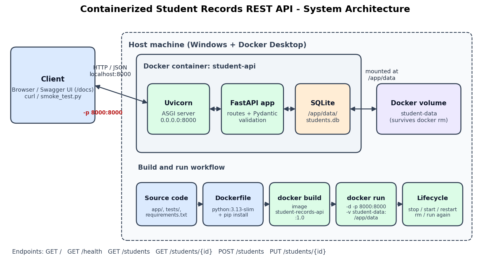

# Containerized REST API for Student Records

**Activity 9 – DevOps Practical**

A simple REST API to add, view and update student records, built with **Python + FastAPI**, stored in **SQLite**, and packaged as a **Docker** container. The data is kept in a Docker volume, so it survives when the container is stopped, removed and recreated.

## Group Members

| Name | Roll No. |
|---|---|
| Riddhi Gopalani | 34124 |
| Om Mahajan | 34140 |
| Sudhan Dabhade | 34118 |
| Pratik Kalburgi | 34130 |

## Problem Statement

Build a simple REST API that supports adding, viewing, and updating student records. Package the application into a Docker container and demonstrate that it can be started, stopped, and recreated without manually configuring the host environment.

## Objectives

1. Implement a basic REST API for student records.
2. Write a Dockerfile and configure the required ports.
3. Demonstrate API functionality and container lifecycle commands (`stop`, `start`, `restart`, `rm`, `run`).
4. Keep the data persistent across container recreation using a Docker volume.

## Tech Stack

| Tool | Purpose |
|---|---|
| Python 3.13 | Programming language |
| FastAPI | Web framework for the REST API (also gives Swagger docs at `/docs`) |
| Uvicorn | ASGI server that runs the FastAPI app |
| SQLite | Lightweight file-based database |
| Docker / Docker Desktop | Containerization |
| Pytest | Automated testing |

## Architecture



The client (browser, Swagger UI or curl) sends HTTP requests to `localhost:8000`. Docker forwards host port 8000 to port 8000 inside the `student-api` container, where Uvicorn runs the FastAPI app. The app stores records in `/app/data/students.db`, and that folder is a Docker volume (`student-data`) that lives outside the container.

## Project Structure

```
Containerized-REST-API-for-Student-Records/
├── app/
│   ├── __init__.py
│   ├── main.py          # FastAPI app and API endpoints
│   ├── database.py      # SQLite functions (create table, insert, select, update)
│   └── schemas.py       # Pydantic models for input validation
├── tests/
│   └── test_api.py      # 11 automated pytest tests
├── scripts/
│   └── smoke_test.py    # Live test against the running container (+ recreation check)
├── data/                # Local SQLite database folder (db file is git-ignored)
├── docs/
│   └── architecture.png # Architecture / workflow diagram
├── Dockerfile
├── .dockerignore
├── .gitignore
├── pytest.ini
├── requirements.txt
└── README.md
```

## API Endpoints

| Method | Endpoint | Purpose | Success code |
|---|---|---|---|
| GET | `/` | Welcome message and list of endpoints | 200 |
| GET | `/health` | Health check (also used by Docker HEALTHCHECK) | 200 |
| GET | `/students` | View all students | 200 |
| GET | `/students/{student_id}` | View one student by ID | 200 |
| POST | `/students` | Add a new student | 201 |
| PUT | `/students/{student_id}` | Update an existing student | 200 |

**Error responses**

| Situation | Code |
|---|---|
| Student ID does not exist | 404 Not Found |
| Missing field, invalid email, too-short name, non-numeric ID | 422 Unprocessable Entity |
| Roll number already used by another student | 409 Conflict |

**Student record fields:** `id` (auto-generated), `name`, `roll_no` (unique), `department`, `email`.

Three sample students are inserted automatically the first time the database is created.

Example request body for POST / PUT:

```json
{
  "name": "Priya Deshmukh",
  "roll_no": "CS104",
  "department": "Computer Engineering",
  "email": "priya.deshmukh@example.com"
}
```

## Running with Docker (recommended)

Only Docker Desktop is needed – no Python installation on the host.

```bash
# 1. Build the image
docker build -t student-records-api:1.0 .

# 2. Run the container (port 8000, data stored in the student-data volume)
docker run -d --name student-api -p 8000:8000 -v student-data:/app/data student-records-api:1.0

# 3. Check it is running
docker ps
```

Then open:

- http://localhost:8000/docs – Swagger UI (try all endpoints from the browser)
- http://localhost:8000/students – all students
- http://localhost:8000/health – health check

**What the `docker run` options mean**

| Option | Meaning |
|---|---|
| `-d` | Run in the background (detached) |
| `--name student-api` | Give the container a fixed name |
| `-p 8000:8000` | Map host port 8000 → container port 8000 |
| `-v student-data:/app/data` | Store the database in a named Docker volume so it survives `docker rm` |

## Container Lifecycle Commands

```bash
docker stop student-api        # stop the running container (status: Exited)
docker start student-api       # start the same container again
docker restart student-api     # stop + start in one command
docker logs student-api        # view the server logs
docker rm student-api          # remove the container (must be stopped first)
docker run -d --name student-api -p 8000:8000 -v student-data:/app/data student-records-api:1.0   # recreate
docker volume ls               # the student-data volume is still there after docker rm
```

After `docker rm` and `docker run`, the new container has a new container ID but uses the same `student-data` volume, so all previously added students are still available.

## Running Locally (without Docker)

```bash
python -m venv .venv
.\.venv\Scripts\python.exe -m pip install -r requirements.txt
.\.venv\Scripts\python.exe -m uvicorn app.main:app --reload --port 8000
```

## Testing

**Automated tests (pytest)** – each test uses its own temporary database:

```bash
.\.venv\Scripts\python.exe -m pytest -v          # on the host
docker exec student-api python -m pytest -v      # inside the container
```

**Live test against the running container** (standard library only):

```bash
python scripts/smoke_test.py --recreate
```

`--recreate` also removes and recreates the container and checks that the data is still there. Note: every run adds one test student (roll number starting with `T`).

### Test Results

| # | Test case | Expected result | Actual result | Status |
|---|---|---|---|---|
| 1 | Health check `GET /health` | 200, `{"status": "ok"}` | 200, `{"status": "ok"}` | Pass |
| 2 | Add a student `POST /students` | 201 with new ID | 201, new ID returned | Pass |
| 3 | View all students `GET /students` | 200, list includes new student | 200, new student found | Pass |
| 4 | View student by ID `GET /students/{id}` | 200 with correct record | 200, correct roll number | Pass |
| 5 | Update student `PUT /students/{id}` | 200, department changed | 200, department = Information Technology | Pass |
| 6 | Invalid input – bad email | 422 | 422 | Pass |
| 7 | Invalid input – missing fields | 422 | 422 | Pass |
| 8 | Invalid input – non-numeric ID `/students/abc` | 422 | 422 | Pass |
| 9 | Non-existent ID `GET /students/99999` | 404 | 404, "Student with id 99999 not found" | Pass |
| 10 | Non-existent ID `PUT /students/99999` | 404 | 404 | Pass |
| 11 | Duplicate roll number | 409 | 409 | Pass |
| 12 | API reachable after `docker rm` + `docker run` | 200 on `/health` | 200 | Pass |
| 13 | Data persists after container recreation | Updated record still present | Record present with updated department | Pass |
| 14 | Pytest suite (host) | All tests pass | 11 passed | Pass |
| 15 | Pytest suite (inside container) | All tests pass | 11 passed | Pass |

## Troubleshooting Notes

Points 1–5 and 7 are problems we actually ran into during the practical; points 6 and 8 are precautions we took to avoid common issues.

1. **Docker engine not running** – `docker info` failed with `failed to connect to the docker API at npipe:////./pipe/dockerDesktopLinuxEngine`. The Docker CLI was installed but Docker Desktop was not started. **Fix:** start Docker Desktop and wait until the engine shows as running.
2. **Slow first image build** – the first `docker build` took about 3 minutes because pip downloaded packages slowly. **Fix:** `requirements.txt` is copied and installed before the app code in the Dockerfile, so Docker caches that layer and later builds take only a few seconds.
3. **Git Bash changes container paths** – `docker exec student-api ls /app/data` in Git Bash failed with `cannot access 'C:/Program Files/Git/app/data'`, because Git Bash converts Linux-style paths to Windows paths. **Fix:** run the command in PowerShell, or prefix it with `MSYS_NO_PATHCONV=1` in Git Bash.
4. **PowerShell strips inner quotes** – `docker exec student-api python -c "...'...'..."` failed with a Python `SyntaxError` because PowerShell removed the nested quotes before passing them to Docker. **Fix:** avoid nested quotes in PowerShell (or run such commands from Git Bash / a script file).
5. **Wrong fields in the first POST request** – our first request from Swagger sent an `age` field and left out `roll_no` and `email`, so the API returned `422 Unprocessable Entity` with "Field required" (screenshot 4). **Fix:** send all four required fields; extra fields such as `age` are ignored.
6. **Port 8000 already in use** – the local Uvicorn server and the container both use port 8000. **Fix:** stop the local server (Ctrl+C) before running the container, or map a different host port, e.g. `-p 8080:8000`.
7. **Pytest DeprecationWarning** – pytest shows one warning from inside the Starlette/AnyIO libraries. It comes from the library, not from our code, and does not affect the results.
8. **Server not reachable from outside the container** – Uvicorn must listen on `0.0.0.0` inside the container (not `127.0.0.1`), otherwise the published port does not work. This is set in the Dockerfile `CMD`.

## Screenshots

| # | Screenshot | Shows |
|---|---|---|
| 1 | [1.png](screenshots/1.png) | Uvicorn server running locally |
| 2 | [2.png](screenshots/2.png) | Swagger docs at `/docs` with all six endpoints |
| 3 | [3.png](screenshots/3.png) | `GET /students` – three sample records |
| 4 | [4.png](screenshots/4.png) | Validation error – 422 for missing `roll_no` / `email` |
| 5 | [5.png](screenshots/5.png) | `POST /students` – 201 Created |
| 6 | [6.png](screenshots/6.png) | `PUT /students/4` – 200 OK |
| 7 | [7.png](screenshots/7.png) | `GET /students/4` – updated record |
| 8 | [8.png](screenshots/8.png) | `GET /students/99` – 404 Not Found |
| 9 | [9.png](screenshots/9.png) | `docker build` – image built |
| 10 | [10.png](screenshots/10.png) | `docker images` and `docker ps` – container running (healthy) |
| 11 | [11.png](screenshots/11.png) | `POST /students` through the Docker port – 201 Created |
| 12 | [12.png](screenshots/12.png) | `GET /students` through the Docker container |
| 13 | [13.png](screenshots/13.png) | `docker logs student-api` |
| 14 | [14.png](screenshots/14.png) | Lifecycle – stop, start, restart, rm, volume ls, run |
| 15 | [15.png](screenshots/15.png) | Smoke test – 12/12 checks passed incl. recreation and persistence |


## Project Documents

- [Project Report (Word)](docs/Activity9_Project_Report.docx)
- [Presentation (PowerPoint)](docs/Activity9_Presentation.pptx)
- [Architecture Diagram](docs/architecture.png)

## Individual Contributions

| Member | Roll No. | Contribution |
|---|---|---|
| Riddhi Gopalani | 34124 | GitHub repository and project setup, FastAPI endpoints, SQLite database layer, input validation, Docker volume persistence, final demonstration, screenshots and commits |
| Om Mahajan | 34140 | Dockerfile, .dockerignore, port mapping and health check, image build, container lifecycle demonstration |
| Sudhan Dabhade | 34118 | Pytest test cases, live smoke test script, test execution on host and container, troubleshooting notes |
| Pratik Kalburgi | 34130 | Project report, presentation, architecture diagram, README documentation |
